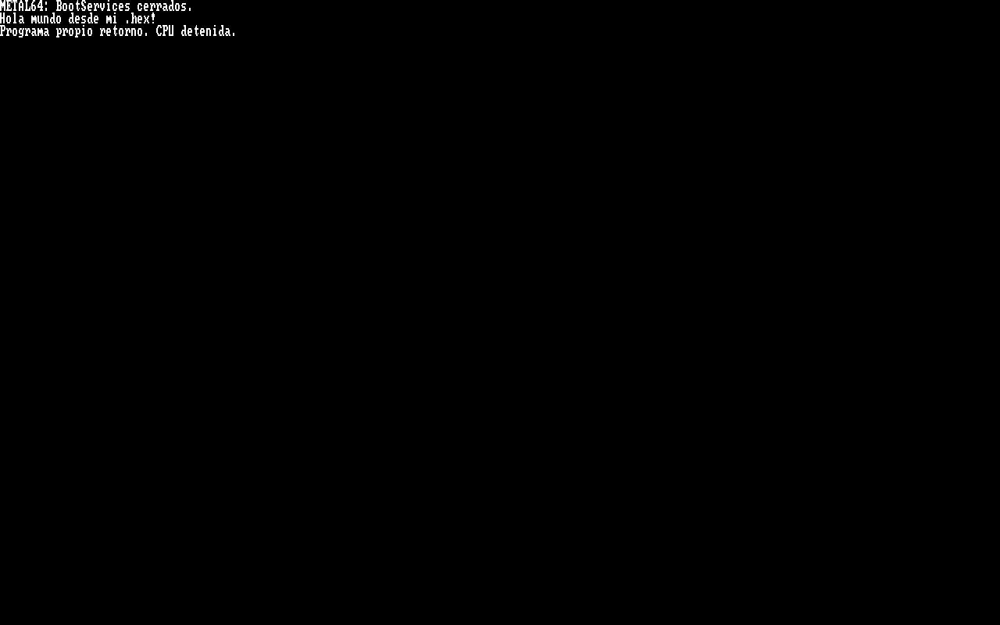

# CASM 0.1 — compiler foundation evidence

Recorded on 2026-10-18. These are host-tool tests and a QEMU/OVMF execution;
they do not replace the earlier physical photographs of the hand-written hello.

## Host compiler and two controls

`CASM/test.ps1 -Qemu` builds the C host tool with installed Clang using C11,
`-Wall -Wextra -Werror -pedantic -O2`. Clang bootstraps the host compiler;
our C emitter independently encodes the target instructions.

[host-tests.json](host-tests.json) records 39 passing cases:

- 6 accepted programs: golden hello, empty entry, multiple strings/calls, unused
  constant warning, comments/escapes/CRLF and the exact 4096-byte packet limit.
- 23 rejected sources: undefined/duplicate/reserved names, unsupported operations,
  pointers and writes, initializer type, return discipline, trailing definitions,
  malformed strings/comments, preprocessor, source encoding, size/call limits,
  and the superseded proposal syntax. Rejections emitted no HEX or IR in fresh runs.
- 10 rejected output mutations: opcode, displacement, RET, extra byte, malformed
  HEX, wrong ABI, code/data offsets, call target and embedded NUL. The verifier CLI
  refused to publish a packet for each mutation.

[hello.hex](hello.hex), [hello.ir.json](hello.ir.json) and
[hello.verified.json](hello.verified.json) preserve the golden output and mapping.
The report's source hash corresponds to [hello.casm](../../CASM/examples/hello.casm).
The 40-byte body plus 24-byte FAGRAW64 header exactly equals the prior manual
64-byte packet, SHA-256:

```text
b3fd9814bcce6881f9cf3ad10b299d759f4f5b801a6526c59131a4d1c84e4b33
```

The verifier checks structure against compiler IR; it does not independently
reparse source semantics. A successful test suite is not proof of all inputs,
Rust memory safety or C conformance.

## Target execution

The test script creates a GPT/FAT32 virtual image using `build/CASM/hello.x86`
as the payload, installs the existing bridge into that image, and reuses the
instrumented bridge harness. [qemu-tests.json](qemu-tests.json) records successful
ExitBootServices, payload return, CPL0, code-body identity in memory and exact
framebuffer pixels. The reference packet used by that harness is first checked
byte-identical to CASM's packet by the integration script.



The screenshot is an actual QMP screendump. The payload returns and the bridge
halts intentionally. The generated image ran with snapshot mode; no physical
SSD or UEFI entry was modified. No new physical test of compiler output is claimed.

[manifiesto.json](manifiesto.json) records evidence file hashes. Reproduce with:

```powershell
.\CASM\test.ps1 -Qemu
```
