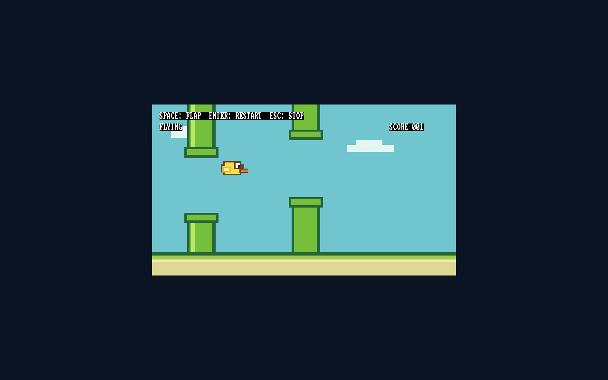
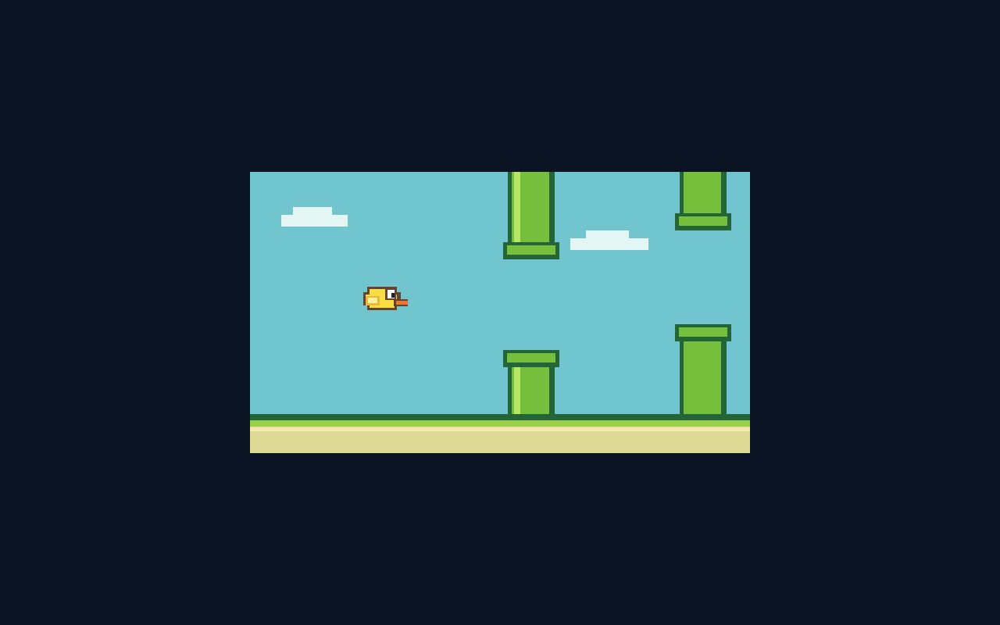

# Flappy Metal: escena y juego en QEMU

## Prototipo jugable

El siguiente hito añade salto con Espacio, gravedad, tuberías móviles, colisiones,
puntuación, reinicio con Enter y parada con Escape. F12 pausa/reanuda. Se ejecuta
después de BootServices, con teclado PS/2 y PIT consultados directamente en QEMU.
No se ha instalado este juego en el SSD real.

[Resumen: 19/19 comprobaciones aprobadas](game-suite-results.json).



El [informe de juego](game-test-results.json) registra siete comprobaciones:
pantalla/código inicial, regulación temporal, impulso por pulsación y gravedad,
colisión, reinicio, vuelo con puntuación y parada definida. Las imágenes de
[inicio](02-game-ready.png), [fin de partida](03-game-over.png) y vuelo se
compararon píxel a píxel contra una referencia separada, incluido el texto.
La [parada](05-game-stopped.png) es una captura posterior a Escape.

Siete paquetes de prueba aislados ejercitan [techo](game-test-ceiling.json),
[tubería](game-test-pipe.json), [reciclado](game-test-wrap.json),
[límite de puntuación](game-test-scorecap.json), [recorte](game-test-clip.json),
[timeout de temporizador](game-test-timerfault.json) y
[timeout de teclado](game-test-keyboardfault.json). Los dos últimos son fallos
inyectados en copias de prueba, no fallos observados del hardware físico.

El caso de reciclado reveló un salto inicial ausente: podía ejecutarse relleno.
Se añadió el salto y los casos aislados comprueban ahora exactamente un paso de
simulación y ningún frame normal previo. Además, el constructor verifica 86
operandos relativos anotados, con [dos comprobaciones](branch-test-results.json)
que incluyen rechazo de un salto inicial alterado. Esto no es prueba formal de
todas las instrucciones ni seguridad de memoria de Rust.

El [paquete normal](game.json) ocupa 4088 bytes (4064 de cuerpo), entrada 0x600.
Sus bytes coinciden con los copiados a RAM en la prueba. Los registros de trabajo
permanecen en el contexto y no modifican el cuerpo del paquete. Las instrucciones
están en game.hex y scene.hex; CASM todavía no genera este juego.

El reloj es nominalmente de 60 pasos/s mientras el dibujo cabe en el intervalo;
no se recuperan pasos perdidos bajo carga. La medición del informe es una
comprobación amplia de QEMU, no un benchmark del Ryzen. No se habilitan IRQ ni
se instala una IDT propia en este prototipo. El teclado USB real sigue pendiente.

## Primer hito conservado: escena estática

Pruebas del 18 de octubre de 2026. Este fue el primer paso gráfico estático;
el juego posterior se documenta arriba. La CPU dibuja 38 rectángulos después de ExitBootServices, usando el
framebuffer que dejó inicializado el firmware virtual. No se usa una API gráfica
del sistema anfitrión para producir el dibujo del invitado.



La captura procede de QMP screendump; no fue generada ni retocada. El framebuffer
es BGR de 32 bits, 1280×800 con stride 1280. Se compararon exactamente 1.024.000
píxeles contra una referencia de rectángulos independiente del código máquina.
La escena tiene un lienzo de 640×360 centrado y un borde oscuro.

| Informe | Resultado |
|---|---|
| [Normal](test-normal.json) | Salida de BootServices, ejecución CPL0, copia exacta del cuerpo en RAM, testigo de escena lista y píxeles exactos |
| [Coordenada inválida](test-outside.json) | Desbordamiento al centrar rechazado; solo el fondo inicial válido fue dibujado |
| [Ancho cero](test-empty.json) | Rectángulo vacío rechazado; solo el fondo inicial válido fue dibujado |

La prueba de coordenada inválida reveló un desbordamiento en la primera versión;
se añadió el rechazo antes de dibujar y los tres casos finales pasaron. No se
afirma que estas tres pruebas cubran todas las averías ni todos los modos de vídeo.

El [informe del paquete estático](scene-normal.json) registra 1300 bytes, de los cuales
1276 son cuerpo. Las instrucciones están escritas a mano en
[scene.hex](../../Games/Flappy_Metal/scene.hex); Python empaqueta instrucciones
existentes y datos geométricos. No se presenta como salida del compilador CASM.
Ese paquete estático no incluye movimiento, reloj, entrada ni colisiones. El programa
termina en su propio bucle HLT con la imagen visible; no retorna al texto del puente.

La imagen virtual se ejecutó con snapshot y se verificó que su SHA-256 no cambió.
No se instaló la escena en A: ni se hizo una nueva prueba física. El saludo real
anterior y sus fotografías permanecen separados. [Manifiesto](manifiesto.json).

La reorganización movió 26 archivos a tools/docs y fusionó dos guías repetidas
en Orquestador_Metal/README.md. La [regresión posterior](regression-layout.json)
registra ROM, guardianes, programas, pantalla, FAT32, GPT, arranque, puente,
CASM y análisis MSI aprobados con las nuevas rutas.

Desde la raíz:

```powershell
.\jugar.ps1 -Comprobar
.\jugar.ps1
```
