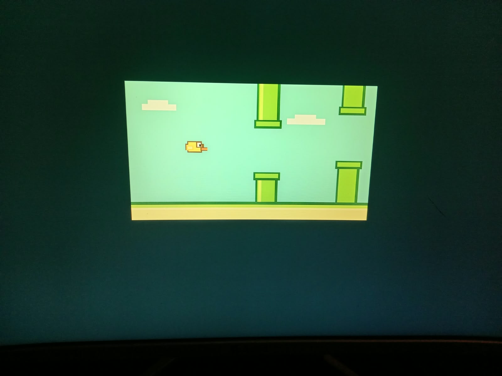

# Flappy Metal: dibujo confirmado en el PC real

Preparación e instalación del 18 de octubre de 2026. Windows enumeró teclados
USB/HID y el usuario confirmó que solo dispone de USB. El juego interactivo
controla PS/2 y PIT en QEMU; no se lo presenta como compatible con el teclado USB
real. Por eso esta primera prueba física contiene únicamente el dibujo estático.

## Estado comprobado

- [Paquete](paquete.json): entrada EFI separada y escena de 1300 bytes.
- [Prueba QEMU](qemu-preview.json): salida de BootServices, código exacto en RAM y
  1.024.000 píxeles comparados con la escena esperada. Se usa la nueva ruta FLAPPY.X86.
- [Instalación](instalacion.json) y [verificación](verificacion.json): huellas
  instaladas coincidentes, saludo anterior intacto, registro idempotente sin duplicados.
- [Entrada](entrada.json): añadida al final y orden anterior conservado; contiene
  las listas de identificadores previas y posteriores a la instalación.
- [Firmware observado](firmware-observado.txt): lectura posterior a la instalación.

El 18 de octubre de 2026 el usuario aportó una foto del dibujo en su PC real y
confirmó que aparece sin movimiento. Es el resultado esperado del paquete estático.
La foto es evidencia visual aportada por el usuario; no contiene una traza de CPU
ni una comparación automática de píxeles del hardware físico.
No se ha modificado la flash BIOS, el tipo de partición ni las rutas de Windows.
Los archivos del saludo anterior conservan las huellas de la [línea base](baseline.json).

| Elemento | Valor |
|---|---|
| Entrada | Flappy Metal (prueba visual) |
| ID | {57cb1746-7f84-11f1-930d-c3a2d7ca848a} |
| EFI | A:\EFI\ORQUESTADOR\FLAPPY.EFI |
| Programa | A:\METAL\FLAPPY.X86 |
| Control | Solo imagen; sin movimiento ni teclado |

## Primera prueba manual

1. Guarda tu trabajo y reinicia manualmente.
2. Pulsa F11 y elige **Flappy Metal (prueba visual)**.
3. Debe aparecer el pájaro, las tuberías y el suelo, centrados sobre un borde oscuro.
4. Toma una foto de toda la pantalla, incluso si aparece un error.
5. La imagen queda fija porque la CPU se detiene intencionalmente. Reinicia
   manualmente y elige Windows Boot Manager para regresar.

Espacio y Enter no juegan en esta versión. La foto confirma el dibujo en
el hardware real; el controlador USB y la prueba interactiva siguen pendientes.

Esta es la [referencia obtenida con el mismo paquete bajo QEMU](qemu-preview.png):


## Resultado físico e impacto



La escena muestra el pájaro, las tuberías, las nubes y el suelo, con margen oscuro.
El usuario reporta que no se mueve. El paquete instalado dibuja una vez y se
detiene intencionalmente; no contiene el bucle jugable.

Esto respalda que la ruta de arranque desde FAT32, el puente EFI y el programa
propio llegan a producir gráficos visibles en este perfil físico. Según el flujo
del código instalado, el dibujo usa escrituras de CPU al framebuffer obtenido
mediante GOP, después de salir de BootServices. La foto por sí sola no mide esa
transición ni verifica todos los guardianes; esa instrumentación está en QEMU.

La CPU ejecuta las instrucciones propias y escribe los píxeles. La GPU mantiene
la salida de vídeo configurada previamente; no se ha desarrollado un controlador
gráfico propio ni se ha reemplazado el firmware de la placa. GOP aporta la
configuración y los datos del framebuffer antes de abandonar BootServices.

El siguiente avance puede aislarse en dos pasos: animación autónoma con un reloj
validado en este PC, y luego entrada USB/HID para jugar. El éxito gráfico no
certifica todavía temporización, teclado, estabilidad prolongada ni otros equipos.
La ausencia de Rust no cambia la evidencia: aquí los límites dependen de los
contratos, verificadores y pruebas implementados, sin garantía general de seguridad
de memoria para instrucciones escritas a mano.

Los JSON de instalación y verificación conservan su estado histórico anterior a
esta foto. [observacion-fisica.json](observacion-fisica.json) registra el nuevo hito.

## Cómo se preparó y cómo retirar la entrada

El constructor cambia solo dos literales UTF-16 del EFI probado: la ruta del
programa y su error de lectura. Verifica que las instrucciones y fuente gráfica
permanezcan idénticas. La escena también queda fijada a su SHA-256 revisado.
[Procedimiento reproducible](../../../Games/Flappy_Metal/PC-PREVIEW.md).

Si se desea retirar solamente esta entrada, en PowerShell con permisos suficientes:

```powershell
bcdedit /delete '{57cb1746-7f84-11f1-930d-c3a2d7ca848a}'
```

Los archivos separados pueden quedar en A:; no alteran las rutas anteriores.
La prueba del juego QEMU sigue disponible con `jugar.ps1`.
