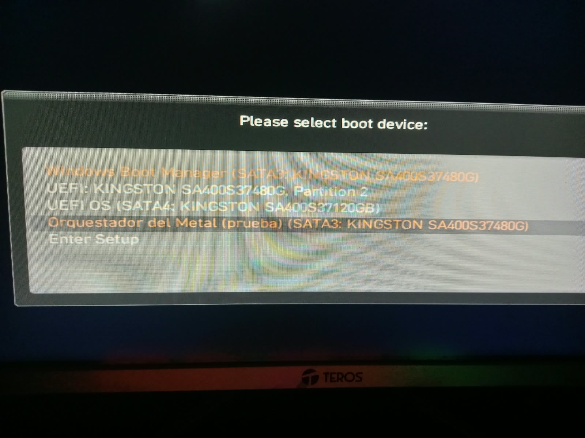
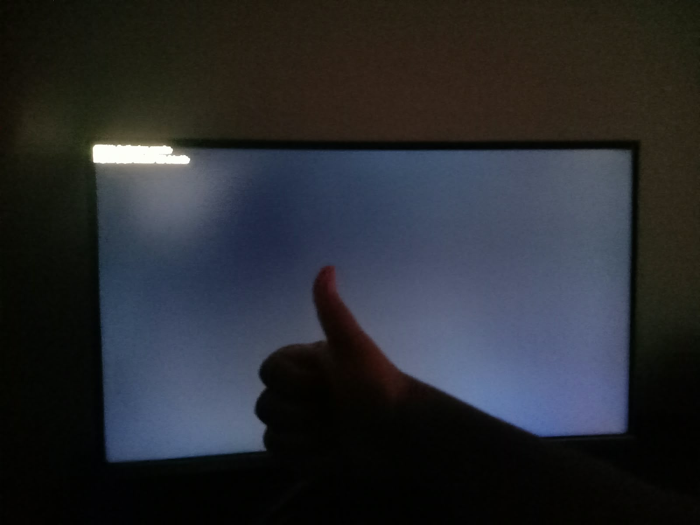

# Primer arranque físico del puente

Recibido el 18 de octubre de 2026. El usuario reporta que funcionó en el primer
intento físico y aporta estas tres fotografías originales. Se copiaron sin
recortar, retocar ni regenerar; las huellas y nombres de origen están en
[manifiesto.json](manifiesto.json). La fecha corresponde a su recepción, no a
metadatos de captura verificados.

## Menú del firmware



Se observa **Orquestador del Metal (prueba)** asociado a SATA3 Kingston
SA400S37480G. El nombre coincide con la entrada creada durante la instalación.

## Resultado legible


La fotografía permite leer:

```text
METAL64: BootServices cerrados.
Hola mundo desde mi .hex!
Programa propio retorno. CPU detenida.
```

En la versión instalada, esas líneas corresponden a la salida exitosa de
BootServices, la ejecución del programa externo y su retorno. La última precede
al bucle HLT. El comportamiento visible concuerda con el recorrido comprobado
instrumentalmente en QEMU/OVMF. La foto no proporciona por sí sola registros de
CPU, mapa de memoria ni una medición independiente de HLT en el Ryzen.

## Vista general



Esta vista aporta contexto físico; el texto está sobreexpuesto, por lo que para
la transcripción se usa la segunda fotografía.

## Versión y alcance

El puente fue implementado en `089d914` y su instalación registrada en `87e022d`.
Los [registros de instalación](../PUENTE_INSTALADO/LEEME.md) indican:

| Archivo instalado | SHA-256 |
|---|---|
| A:\EFI\ORQUESTADOR\METAL.EFI | 4287AD788CB7A75A74922F7F73E69363560C84501B9A73BA271D357F5F71469F |
| A:\METAL\INICIO.X86 | B3FD9814BCCE6881F9CF3AD10B299D759F4F5B801A6526C59131A4D1C84E4B33 |

Son las huellas verificadas al instalar, no huellas extraídas de las fotografías.
El perfil declarado es MSI A320M-A PRO MAX + Ryzen 5 5600X + GeForce RTX 3060.
Las fotos no identifican por sí solas todos esos componentes.

Queda documentado el primer éxito físico reportado del saludo mediante entrada
UEFI, FAT32 y framebuffer heredado. No se acredita arranque propio desde RESET,
reemplazo de BIOS, controlador NVIDIA propio, eco/teclado tras la salida,
repetibilidad prolongada ni ejecución en otras placas. Los seis casos de error
permanecen probados en QEMU, no en el hardware real.

[Explicación del impacto y de trabajar sin Rust](../../../README.md#primer-arranque-real-del-hex-al-ryzen).
