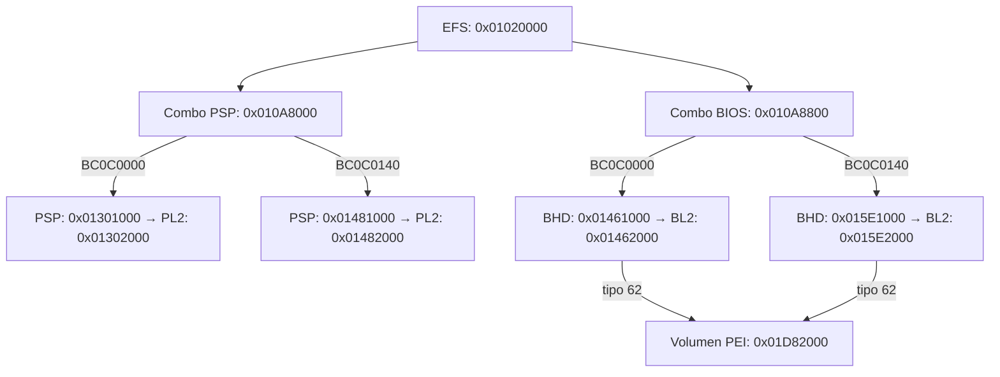

# Trazado AMD y dependencias PEI: resultado de la segunda investigación

La utilidad nueva tools/analysis/trazar-inicio-msi.py sigue enlaces del archivo oficial y decodifica
expresiones de dependencia PEI. No ejecuta los módulos ni modifica el firmware.

## Hallazgo que determina la estrategia

La imagen contiene dos cabeceras EFS, en 0x00020000 y 0x01020000. Un modelo de dos
dominios de 16 MiB permite resolver sus referencias sin mezclar las dos zonas.
Se validan checksum y límites de cada tabla seguida: 9 nodos/7 enlaces en el primer
dominio, 12 nodos/9 enlaces en el segundo. Los nodos incluyen tablas combo, por eso
su número no coincide con las 18 tablas simples del primer inventario.

Es un modelo del archivo corroborado por sus enlaces, no una observación del mapeo
activo del chip. Corrige la limitación del primer inventario: aquel resolvía direcciones
como si toda la imagen fuera un único espacio lineal y dejaba muchas sin resolver.
Las huellas de rangos calculadas entonces no se usarán para extraer componentes;
este trazado mantiene el contexto de dominio en cada referencia. El informe inicial
se conserva como resultado histórico, no como mapa definitivo de integración.

En el segundo dominio aparecen dos IDs que PSPTool clasifica empíricamente como
Zen 3: BC0C0000 y BC0C0140. Windows identifica AMD64 Family 25 Model 33 Stepping 2,
pero ese identificador no equivale a uno de los IDs PSP. No se selecciona uno por
semejanza: sigue pendiente demostrar cuál corresponde a este 5600X y su revisión.

No se han omitido físicamente las demás ramas: el diagrama muestra solo las dos
candidatas Zen 3. Ambas referencias BIOS de tipo 62 llegan al mismo volumen PEI.
El grafo íntegro, incluidas otras ramas, está en [trazado.json](trazado.json).

## Qué exige el entorno de inicialización

Se examinaron 243 archivos PEIM visibles entre ambos dominios. Sus dependencias
son condiciones previas de despacho, no la lista completa de funciones llamadas.
No se han descomprimido módulos ni identificado todos los proveedores de PPIs.

| Módulo visible | Offset FFS en archivo | Dependencias PPI declaradas |
|---|---|---|
| AmdSocAm4VmrPei | 0x01E40770 | Tres, combinadas con AND |
| AmdCcxZen3Pei | 0x01DA4178 | Nueve, combinadas con AND |
| AmiAgesaPei (segundo dominio) | 0x01E5B230 | Tres, combinadas con AND |

Los offsets se pueden contrastar con el JSON; no son direcciones a las que saltar.
Para AmdSocAm4VmrPei se leen estas tres dependencias:

- 01f34d25-4de2-23ad-3ff3-36353ff323f1: PCD de PI, acceso a la configuración de plataforma; proveedor de esta imagen aún sin demostrar.
- 2ab86ef5-ecb5-4134-b556-3854ca1fe1b4: ReadOnlyVariable2, lectura de variables PEI.
- 04126c85-5c4e-458f-abc1-29f1f7da365e: todavía sin proveedor identificado.

AmiAgesaPei exige ReadOnlyVariable2, la PPI PCD anterior y
9ca93627-b65b-4324-a202-c0b461764543, que corresponde a Smbus2. Los tres nombres
estándar se contrastaron con los encabezados de EDK II; los no identificados se conservan
como GUID sin inventarles nombre ni implementación.

Cumplir DEPEX no garantiza que podamos ejecutar un módulo: también necesita sus
servicios PEI, parámetros, relocaciones, estado previo y otras dependencias de código.
La conclusión es concreta: conservar estos binarios exige conservar o proporcionar
ese entorno. No se ha encontrado aquí un AGESA autónomo que podamos llamar desde
nuestro monitor como una subrutina.

## Punto de integración que investigaremos

La primera candidata razonable es preservar el bloque de inicio de plataforma como
unidad, incluyendo lo que sus módulos necesitan, y situar el código propio después
de que se haya preparado memoria. Eso puede conservar fases internas PI/UEFI de
AMD/AMI aunque no se use una aplicación .efi en el USB. No se describe como firmware
sin ningún componente UEFI. Separar únicamente AMD y reemplazar todo AMI requeriría
resolver los proveedores y contratos que ahora aparecen como dependencias.

Antes de escribir un salto hay que definir la entrega real: modo de CPU, pila,
memoria libre/reservada, tablas conservadas, estado de interrupciones y acceso a
vídeo/almacenamiento. El mapa fijo de QEMU no debe sustituir las reservas de esta
plataforma. El permiso para considerar esa entrega implementada sigue bloqueado:
aún no existe código de integración ni una imagen modificada para MS-7C52.

Este análisis reduce una incertidumbre: ya sabemos por qué copiar los binarios AMD
junto a nuestros .hex no basta y qué interfaces concretas debemos seguir. El siguiente
trabajo es identificar sus proveedores y el límite posterior al inicio de memoria;
no grabar la ROM de QEMU ni renombrar un archivo en FAT32.

## Comprobaciones y reproducción

`./tools/analysis/analizar-msi.ps1` ahora ejecuta inventario, trazado y ambos grupos de pruebas:
5 comprobaciones previas y 11 nuevas. [pruebas-trazado.json](pruebas-trazado.json)
registra los rechazos de GUID truncado, pila inválida, opcode DXE en PEI, falta de END,
datos sobrantes, checksum combo alterado y enlaces fuera de dominio incluso con
checksum reparado. También comprueba el modo de direccionamiento, que un ID desconocido
no seleccione la CPU y que el ZIP original conserve su huella.

No se vuelve a contar una comprobación estática como prueba física. Las variables
RuntimeSatisfied y ActiveOnPhysicalCPU permanecen sin confirmar en el informe.

## Fuentes primarias

- [coreboot: estructuras EFS, combo y directorios AMD](https://github.com/coreboot/coreboot/tree/main/src/vendorcode/amd/psp).
- [coreboot: resolución de modos en amdfwread](https://github.com/coreboot/coreboot/blob/main/util/amdfwtool/amdfwread.c).
- [PSPTool: clasificación empírica de generaciones](https://github.com/PSPReverse/PSPTool/blob/master/psptool/directory.py).
- [EDK II: opcodes de dependencia PI](https://github.com/tianocore/edk2/blob/master/MdePkg/Include/Pi/PiDependency.h).
- [EDK II: ReadOnlyVariable2](https://github.com/tianocore/edk2/blob/master/MdePkg/Include/Ppi/ReadOnlyVariable2.h)
  y [Smbus2](https://github.com/tianocore/edk2/blob/master/MdePkg/Include/Ppi/Smbus2.h).
- [EDK II: PCD de PI](https://github.com/tianocore/edk2/blob/master/MdePkg/Include/Ppi/PiPcd.h).
