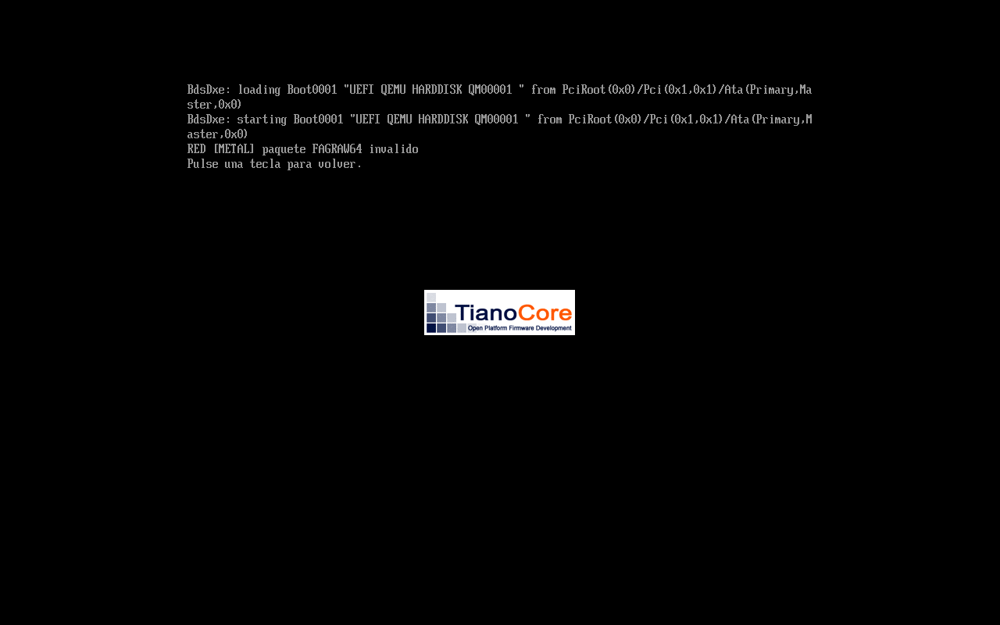
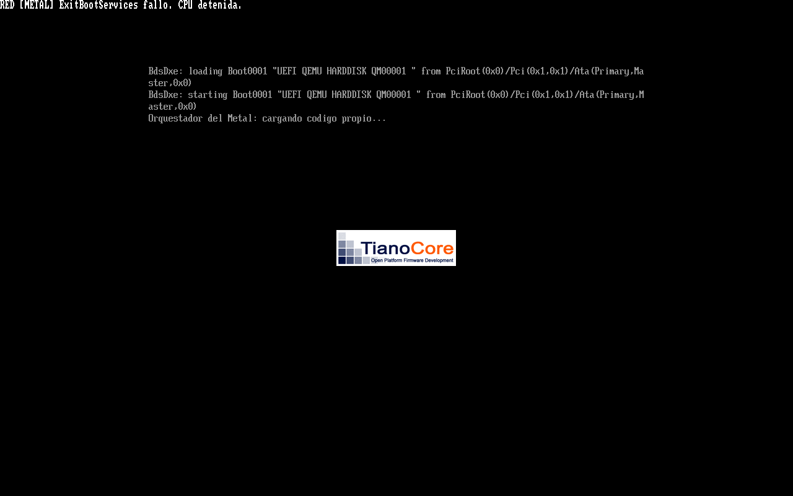

# Evidencias del puente UEFI → código propio

Prueba en QEMU pc / qemu64 / TCG / una CPU / 256 MiB, con el OVMF incluido en QEMU.
No es una prueba física del Ryzen. La autorización actual permite el .efi mínimo
para entrar al código propio después de salir de los servicios de arranque.

[pruebas.json](pruebas.json) registra siete casos aprobados:

| Caso | Resultado comprobado |
|---|---|
| Normal | ExitBootServices exitoso, cuerpo propio exacto en LoaderCode, retorno en CPL0, HLT y framebuffer comparado píxel a píxel |
| Firma dañada | Rechazo antes de salir de UEFI y sin retorno del payload |
| Suma dañada | Rechazo antes de salir de UEFI y sin retorno del payload |
| Archivo ausente | Motivo de lectura, sin salto al programa |
| Archivo de 4097 bytes | Rechazo por longitud |
| Entrada fuera del cuerpo | Rechazo antes del salto |
| MapKey cero, solo en copia de prueba | Tres reintentos acotados y HLT sin ejecutar payload; no se marca salida exitosa |

Los casos de rechazo verifican el motivo guardado por el cargador y los indicadores
del contexto. No se simulan todas las averías de firmware. La comprobación de memoria
incluye tipos de reserva LoaderCode/LoaderData en el mapa previo a la salida; no
certifica permisos de página posteriores ni ausencia de servicios runtime/SMM.
Las imágenes base conservan SHA-256 antes y después de QEMU (snapshot=on).

Las capturas proceden de QMP screendump. Los informes de inspección PE32+ de
[hola](inspeccion-hola.json), [eco](inspeccion-eco.json) y [puente](inspeccion-puente.json)
registran cabeceras y huellas; no son pruebas de ejecución de sus secciones extraídas.

[Guía de uso y límites](../../Puente_Metal/LEEME.md).

La utilidad de inspección también rechazó cinco archivos PE alterados: cabecera
fuera de límites, arquitectura incorrecta, sección fuera de archivo, entrada sin
bytes asociados y archivo truncado. [Resultados](pruebas-inspeccion.json).
