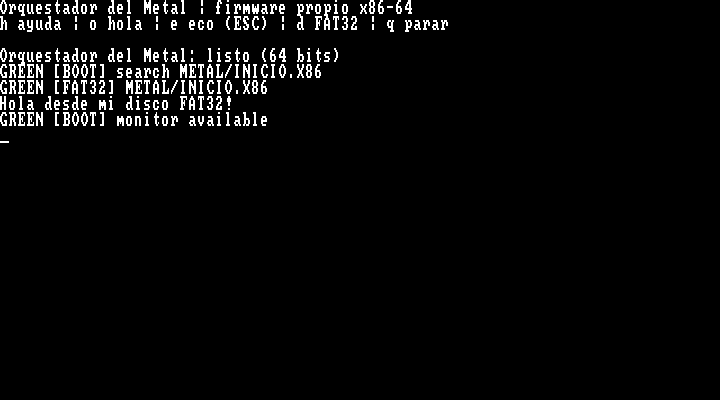
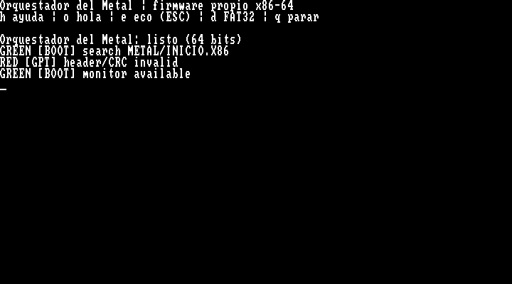
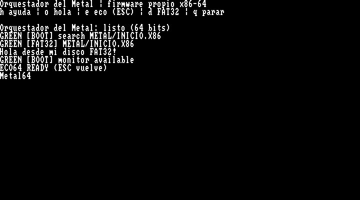
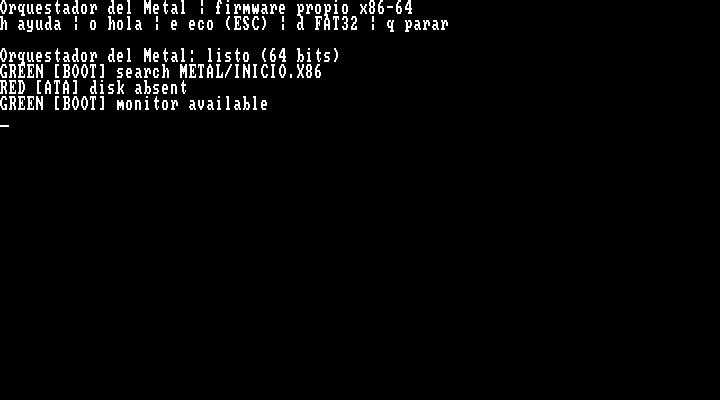

# Orquestador del Metal — cierre v1 para QEMU

Comprobado el 18 de octubre de 2026 con QEMU pc, CPU qemu64, TCG, 16 MiB y una CPU.
Esta entrega arranca el firmware propio desde RESET y llega a una consola de
64 bits con pantalla, teclado y carga de programas externos. No usa una entrada
`.efi`. No es una implementación completa de UEFI ni una ROM para la placa MSI.

## Por qué lo construimos

El objetivo es entender y controlar el recorrido desde la primera instrucción
hasta ejecutar un binario propio. Los bytes de CPU siguen escritos a mano en
`.hex`; el constructor los coloca y comprueba sus contratos. El nombre recuerda
la inspiración de Federico Faggin y el trabajo directo con el procesador.

Las etapas de 16, 32 y 64 bits están separadas porque cada transición establece
condiciones que necesita la siguiente: segmentos y tablas, modo protegido,
paginación y modo largo. El monitor permite observar y ejercitar esa base.
FAT32 y GPT aportan formatos documentados para encontrar el programa externo;
no convierten este firmware en UEFI ni son necesariamente la opción más optimizada.

Los guardianes convierten errores concretos en motivos visibles: rojo bloquea o
rechaza; amarillo avisa de margen o cobertura; verde confirma una comprobación.
Se protegen límites de fuentes, reservas, contratos de bytes, páginas, cadenas
y particiones. No demuestran por sí solos la corrección de cualquier código futuro.

## Resultado comprobado

| Grupo | Resultado |
|---|---|
| CPU, modos, memoria, excepciones y consola | 15/15 |
| Reglas de construcción | 33/33 |
| Rechazos de paquetes | 8/8 |
| Pantalla y teclado | Dos recorridos aprobados |
| FAT32 y MBR | 26/26 |
| GPT y tamaños de clúster | 24/24 |
| Arranque automático y recuperación | 3/3 |
| Paquete final copiado | Arranque y siete respuestas exactas aprobados |

`./tools/tests/test-firmware.ps1` reproduce la batería. Los resultados detallados quedan en
`build/test-results.json` y los informes de cada grupo. Se comprueba que las
imágenes conservan sus huellas y que los rechazos no ejecutan el programa en RAM.

Se retiraron 739 bytes explícitos de rutas heredadas sin uso: de 13261 a 12522
bytes escritos para el perfil monitor automático. La ROM conserva 65536 bytes
por su mapa fijo; esta limpieza no es una medición de rendimiento.

## Capturas reales de la máquina virtual

El propio QEMU captura su pantalla VGA; no son imágenes recreadas.

Arranque: búsqueda automática en GPT/FAT32, ejecución del saludo externo y retorno.



Guardián: una cabecera GPT dañada se rechaza y deja disponible el monitor.



Teclado y eco: el programa propio recibe `Metal64` mediante PS/2 y muestra el texto.



Recuperación: sin disco se explica la ausencia y se conserva el monitor.



## Usarlo

Desde la raíz:

```powershell
.\iniciar.ps1 -Disco
```

El arranque ejecuta `METAL/INICIO.X86` y ofrece el monitor. `h` muestra ayuda,
`o` ejecuta hola mundo, `e` abre eco, Escape vuelve y `q` detiene la CPU virtual.
`-Manual` deja la carga externa para la orden `d`.

```powershell
.\preparar.ps1
.\build\Orquestador_Metal\INICIAR.ps1
```

El paquete contiene ROM, disco GPT/FAT32, programas, lanzador y manifiesto SHA-256.
Requiere QEMU instalado. El lanzador acepta `-Qemu` con su ruta si es necesario.
No instala ni escribe el firmware de la placa física.

## Límites de esta entrega

La lectura está acotada a IDE PIIX/ATA LBA28, sectores de 512 bytes, FAT32 con
clústeres de 1..64 sectores en potencias de dos y una ruta corta 8.3. El paquete
máximo es 4096 bytes. GPT exige cabeceras de 92 bytes, 128 entradas de 128 bytes,
tabla principal en LBA2 y respaldo 33 sectores antes del final. Ambas copias deben
ser válidas y consistentes; no hay reparación automática. Se selecciona una sola
partición Basic Data o ESP con atributos cero. El [contrato de almacenamiento](64-bit/storage/README.md)
detalla los rechazos y presupuestos.

CRC y checksum no autentican programas. Los programas se ejecutan privilegiados
y deben respetar el retorno; uno que se detenga no puede ser recuperado por este
monitor. No se han simulado todas las averías físicas de ATA/UART.

La inicialización de RAM, chipset y dispositivos de la A320M/Ryzen requiere otro
trabajo específico de plataforma. Copiar esta ROM a FAT32 no hace que la placa
la ejecute desde RESET. La v1 queda terminada y probada para la máquina QEMU descrita.
