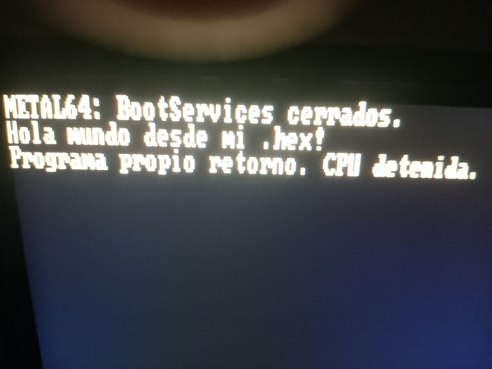

# Orquestador del Metal

Firmware propio x86-64 para aprender y controlar el arranque de **mi PC**, con
instrucciones escritas a mano en `.hex`. «Faggin scaling» conserva el nombre de
las etapas de 16, 32 y 64 bits, en homenaje a Federico Faggin.

**Un único objetivo físico: MSI A320M-A PRO MAX (MS-7C52) + Ryzen 5 5600X.**
Se investigará la integración conservando componentes AMD necesarios. No se
pretende construir un UEFI universal ni mantener soporte para otras placas.
El alcance y los criterios para terminar están en [PERFIL-FISICO](PERFIL-FISICO.md).

El [plan del orquestador y primer juego](PLAN-ORQUESTADOR.md) ordena el siguiente
trabajo: contratos, CASM numérico, dibujo, tiempo, entrada y juego tipo Flappy Bird.
Es un plan, no un juego ya implementado. La limpieza conservadora se previsualiza
con `./clean-workspace.ps1` y se aplica con `-Apply`.

## Ruta actual: .efi mínimo y después código propio

El usuario aceptó esta vía para la primera prueba real. El .efi carga
METAL/INICIO.X86 desde FAT32, obtiene GOP y el mapa de memoria, llama a
ExitBootServices y ejecuta el cuerpo propio en 64 bits. La prueba inicial dibuja
el saludo directamente en el framebuffer y se detiene. No ofrece teclado ni eco
tras salir de UEFI; tampoco reemplaza el firmware de la placa.

```powershell
.\iniciar-puente.ps1
.\iniciar-puente.ps1 -Comprobar
```

Las siete comprobaciones QEMU/OVMF pasaron. El [puente y su contrato](Puente_Metal/LEEME.md),
las [capturas](EVIDENCIAS/PUENTE_UEFI/LEEME.md) y los archivos en build/Puente_Metal
permiten revisar el resultado. Ya se instaló en A: BMO y el usuario aportó fotos
del primer arranque real exitoso el 18 de octubre de 2026. La investigación MSI desde RESET se conserva como
una vía separada; no es requisito para probar este saludo.

## Primer arranque real: del .hex al Ryzen

El 18 de octubre de 2026 el usuario reportó éxito en el primer intento físico del
puente en su MSI A320M-A PRO MAX con Ryzen 5 5600X. La fotografía del menú muestra
**Orquestador del Metal (prueba)** en el SSD Kingston SATA y la del resultado
permite leer las tres líneas esperadas:



```text
METAL64: BootServices cerrados.
Hola mundo desde mi .hex!
Programa propio retorno. CPU detenida.
```

El recorrido implementado es:

```text
Firmware MSI → entrada EFI en FAT32 → validar INICIO.X86
             → ExitBootServices → instrucciones x86-64 propias
             → texto en framebuffer → retorno → HLT
```

Esto importa porque el ejemplo salió del emulador y alcanzó la pantalla del
equipo objetivo. En el código probado, la primera línea solo se dibuja después
de que ExitBootServices devuelve éxito; la segunda procede del programa externo
y la tercera se dibuja después de su retorno. Las fotos son evidencia visual
coherente con ese recorrido, no una traza de registros del Ryzen. «CPU detenida»
es el mensaje previo al bucle HLT previsto; no es un informe de avería.

### Por qué funcionó y qué impacto tiene

- **Un contrato pequeño y comprobado.** El firmware carga un PE32+ x64 válido;
  el puente lee y valida el paquete propio y le entrega una pila, un contexto y
  servicios de texto definidos. El .x86 conserva su formato y no necesita ser .efi.
- **Aprovechar la inicialización existente.** MSI/AMD y el firmware de vídeo ya
  prepararon CPU, RAM y GPU. GOP entrega los datos del framebuffer antes de la
  salida; después nuestras instrucciones escriben los píxeles directamente.
  Este saludo no necesita implementar la inicialización DDR4 ni un driver NVIDIA.
- **Guardianes en los puntos de entrega.** Se comprueban formato GOP, dimensiones,
  memoria, firma, longitud, entrada y suma del paquete; la salida tiene reintentos
  acotados. QEMU/OVMF aprobó siete casos antes de la prueba física. Las fotos
  muestran el camino exitoso; no prueban los rechazos ni todas las posibles averías
  en esta placa.
- **Una base real para avanzar.** Ya hay una ruta de carga y salida a código
  privilegiado en este PC, sin modificar su chip BIOS. Se pueden desarrollar
  teclado/eco, excepciones y memoria propias sobre una entrega de control conocida.

### Sin Rust: qué demuestra

Las instrucciones del puente y del ejemplo están escritas a mano como bytes
`.hex`; los scripts de construcción las colocan y comprueban. No se usó Rust,
un ensamblador ni un linker para emitir esas instrucciones. La CPU ejecuta su
codificación x86-64: no exige un lenguaje concreto para producirla.

El primer intento exitoso que reporta el usuario demuestra que esta combinación
concreta funciona; no establece que prescindir de Rust produzca mayor seguridad,
velocidad o menos errores. Los guardianes aportan comprobaciones explícitas,
pero no equivalen a un sistema de tipos, un borrow checker ni aislamiento de
memoria. Una instrucción o dirección incorrecta todavía puede corromper memoria
o detener el equipo. No se ha medido rendimiento frente a Rust, C o FASM.

El hito alcanzado es **código propio ejecutándose después de BootServices en el
PC real**. El firmware desde RESET sigue siendo el de MSI; se conservan el estado
de plataforma y los componentes runtime/SMM/AMD. Todavía no hay teclado/eco real,
GDT/IDT ni paginación propias en este puente, ni soporte demostrado en otras PCs.

Las [tres fotos originales y su informe](EVIDENCIAS/PC_REAL/PRIMER_ARRANQUE/LEEME.md)
quedan separadas de las capturas QEMU, con huellas SHA-256 y referencia al paquete
instalado. Es un primer arranque reportado, no una campaña de estabilidad repetida.

## Estado real

**CASM 0.1 ya compila:** frontend y emisor escritos en C, con palabras clave y
diagnósticos en inglés, guardianes semánticos y verificador separado de emisión
HEX. El [compilador y su ejemplo](CASM/README.md) producen el mismo paquete de
saludo de 64 bytes; 39 casos y su ejecución QEMU/OVMF están comprobados. El éxito
físico anterior corresponde al .hex manual. El [registro de cobertura de C](CASM/LANGUAGE.md)
define lo aceptado y lo pendiente: no se anuncia compatibilidad con todo C ni Rust.

```powershell
.\CASM\compile.ps1
.\CASM\test.ps1 -Qemu
```

| Parte | Estado |
|---|---|
| Firmware desde RESET en QEMU | v1 terminada y probada: consola, pantalla, teclado, memoria, saludo/eco y carga FAT32 |
| Análisis del firmware oficial MSI 2.C | Inventario y trazado AMD/PEI implementados; 16 comprobaciones aprobadas |
| Entrada .efi → código propio | Siete casos QEMU/OVMF aprobados; primer arranque físico exitoso reportado y fotografiado |
| Firmware MSI propio desde RESET | Investigación separada: aún no hay imagen modificada para grabar |

La ROM de QEMU sustituye el firmware de la VM; no carga SeaBIOS, OVMF ni una
aplicación `.efi`. Para el equipo real se aceptó ahora el puente .efi mínimo. La otra vía, integrar
componentes AMD en firmware propio desde RESET, puede requerir conservar o
proporcionar fases internas PI/UEFI y partes de AMI; no está completada. «Propio» no convierte los componentes conservados en código nuestro.

## Ejecutar lo que ya funciona en QEMU

Desde la raíz, con QEMU instalado:

```powershell
.\iniciar.ps1
```

| Tecla | Acción |
|---|---|
| `h` | Ayuda |
| `s` | Estado de memoria |
| `a` | Reserva de 256 bytes |
| `o` | Hola mundo propio |
| `e` | Eco; Escape vuelve al monitor |
| `d` | Cargar METAL/INICIO.X86 del disco virtual adjunto |
| `q` | Detener la CPU virtual |

No hace falta Enter para elegir una orden. En el eco, Enter cambia de línea y
se puede borrar. `-SoloTerminal` usa UART sin ventana; `-Comprobar` ejecuta una
comprobación y cierra su VM. `q` detiene la CPU, no cierra QEMU.

Para ejecutar el programa externo automáticamente desde GPT/FAT32:

```powershell
.\iniciar.ps1 -Disco
```

El firmware busca `METAL/INICIO.X86`. Si falla o el programa retorna, queda el
monitor; `d` reintenta. `-Manual` desactiva el intento automático. El lanzador
regenera una imagen de disco en `build/`, sin escribir discos físicos. El lector
admite MBR, GPT y FAT32 directo, con clústeres de 512 bytes a 32 KiB dentro de
sus [límites documentados](Orquestador_Metal/64-bit/storage/README.md).

```powershell
.\preparar.ps1
.\build\Orquestador_Metal\INICIAR.ps1
```

El paquete contiene ROM, disco GPT/FAT32, ejemplos, lanzador y manifiesto SHA-256.
Es para QEMU; copiarlo a FAT32 no instala firmware desde RESET en la MSI.

## Organización del código propio

```text
Orquestador_Metal/
  16-bit/              RESET, entrada real y transición a 32 bits
  32-bit/              modo protegido, paginación y transición a 64 bits
  64-bit/              diagnóstico, memoria, monitor, programas y dispositivos QEMU
  guardians/           límites, reservas, contratos y motivos de rechazo
  arranque/            contrato de arranque
  build-firmware.ps1   selecciona fuentes .hex y comprueba la ROM
EVIDENCIAS/
  QEMU/                cuatro capturas y resultados de la batería
  PC_REAL/             inventario, fotos y análisis offline de MSI
```

Las etapas están separadas por responsabilidad; comparten CPU y memoria y se
necesitan en orden. No son procesos aislados por hardware.

```powershell
.\run-firmware.ps1 -Stage 16 -Check
.\run-firmware.ps1 -Stage 32 -Check
.\run-firmware.ps1 -Stage 64 -Check
```

Cada ROM QEMU mide 65536 bytes por su mapa fijo. Los perfiles históricos siguen
llamándose `faggin-*`. Sus mapas en `build/*-map.json` indican fuentes, bytes
explícitos, relleno, plataforma y SHA-256. El constructor copia nuestros bytes;
no ensambla ni genera instrucciones. [Guía técnica](Orquestador_Metal/README.md).

## Guardianes y comprobaciones

Rojo bloquea o rechaza con motivo; amarillo avisa de margen o cobertura; verde
confirma una comprobación concreta. En 64 bits hay páginas de guarda, permisos
RX/RW/NX, diagnóstico de excepciones y asignador acotado con bloqueo persistente
ante corrupción. No se utiliza Rust. [Contratos y límites](Orquestador_Metal/guardians/README.md).

```powershell
.\test-firmware.ps1
```

La batería QEMU incluye 15 casos base, 33 reglas del constructor, ocho rechazos
de paquetes, dos recorridos de pantalla/teclado, 26 casos FAT32/MBR, 24 GPT/clústeres
y tres de arranque. Los fallos provocados deben detectarse. Las pruebas cierran
sus propias VM y escriben informes bajo `build/`.

```powershell
.\run-firmware.ps1 -Stress -Check
.\run-firmware.ps1 -Stress -InjectFault -Check
.\run-firmware.ps1 -Exception stack -Check
```

La prueba de RAM hace 32 rondas sobre 1 MiB. Los otros comandos ejercitan detección
de corrupción y un fallo de guarda de pila dentro de la VM.

Para conservar las fotos y los informes de una batería completada:

```powershell
.\recopilar-evidencias.ps1
```

Véanse el [cierre QEMU](Orquestador_Metal/CIERRE-v1.md) y [EVIDENCIAS](EVIDENCIAS/LEEME.md).
Las reducciones históricas y su método están en [COMPACTACION](Orquestador_Metal/COMPACTACION.md);
la limpieza posterior quitó 739 bytes explícitos sin reducir el mapa de 64 KiB.

## Adaptación a este PC, conservando AMD

Se descargó y analizó la referencia oficial MSI 2.C, nominalmente la versión
reportada por Windows en el equipo. Se encontraron tablas AMD y módulos PEI,
incluidos componentes de Zen 3. El [inventario y el trazado](EVIDENCIAS/PC_REAL/analisis-msi/LEEME.md)
distinguen lo observado en el archivo de lo aún no confirmado en hardware.

```powershell
.\analizar-msi.ps1 -Descargar
```

Requiere Python 3; `-Python` permite indicar su ruta. Sin `-Descargar` reutiliza
el ZIP local. Ejecuta cinco comprobaciones del inventario y once del trazado.
No ejecuta componentes AMD, no parchea la ROM y no invoca un grabador. Estas
herramientas del anfitrión no sustituyen las instrucciones .hex del firmware.

El siguiente trabajo está limitado a resolver la ruta del 5600X, sus dependencias
y la entrega al código propio. Antes de escribir físicamente hacen falta el
original de esta unidad y una recuperación externa preparada. El constructor
rechaza `-Platform MS-7C52` con un motivo hasta que exista ese port; por defecto
solo genera `-Platform QEMU`.

## Referencias y trabajo histórico

- [Perfil físico único y criterio de cierre](PERFIL-FISICO.md).
- [Guía de archivos y uso](Orquestador_Metal/LEEME.md).
- [Estado de las entregas](Orquestador_Metal/ENTREGAS.md).
- [Investigación de las fases de firmware](Orquestador_Metal/COMO-SE-CONSTRUYE-UN-FIRMWARE.md).
- `src/hola.hex` y `src/eco.hex`: aplicaciones UEFI históricas; no son la ruta de entrada elegida.
- `src/reset.hex`: primera ROM de 16 bits; `build.ps1` convierte hexadecimal comentado a bytes.
